<div align="center">




<br/>


</div>

---

### `> whoami`

```yaml
nombre:      Juan Esteban Gallo Galeano
rol:         Desarrollador creativo
enfoque:     [experiencias web interactivas, gráficos 3D, visión por computadora]
aprendiendo: [shaders GLSL, rendimiento en WebGL, interacción por gestos]
filosofía:   "La mejor interfaz es la que responde a las personas."
```

### `> proyectos_destacados`

<table>
<tr>
<td>

#### [ MANOS Y PARTÍCULAS ](https://github.com/excainer/manos-particulas-skz)

Galaxia de partículas 3D controlada con gestos de las manos en tiempo real, usando solo la webcam y el navegador.

- **Seguimiento de manos** con MediaPipe: 21 puntos por mano a ~30 fps.
- **Gestos → física:** atracción en remolino, repulsión, ondas expansivas y escala con dos manos.
- **Gesto secreto:** un corazón con las dos manos transforma la galaxia en un corazón 3D que late.
- **Rendimiento:** animación calculada en el *vertex shader* y calidad adaptativa según los fps.
- **Pruebas automatizadas** del detector de gestos con muestras reales grabadas.

<a href="https://excainer.github.io/manos-particulas-skz/"></a>
<a href="https://github.com/excainer/manos-particulas-skz"></a>

</td>
</tr>
<tr>
<td>

#### [ HELADAPP · HELADERIA API ](https://github.com/excainer/HeladeriaAPI)

Sistema de pedidos para una heladería: el cliente pide desde su mesa y la cocina avanza los pedidos en tiempo real. Proyecto final en equipo.

- **API REST** en .NET 10 con arquitectura por capas (Query / Repository) usando Dapper y SQL Server.
- **Reglas de negocio en el servidor:** precios tomados del catálogo, pedidos guardados en una sola transacción y estados que solo avanzan en orden.
- **Frontend en Angular 21** con *signals*: menú personalizable, carrito y seguimiento del pedido con actualización automática.
- **Panel del personal:** cocina por columnas de estado, historial con filtros y resumen de ventas.
- **86 pruebas unitarias** (Vitest) y una API falsa para trabajar el frontend sin base de datos.

<a href="https://github.com/excainer/HeladeriaAPI"></a>

</td>
</tr>
</table>

### `> stack --list`

<p align="left">
  
  
  
  
  
  
  
  
  
  
  
  
  
  
  
</p>

<div align="center">


<sub><code>// fin de la transmisión</code></sub>

</div>
